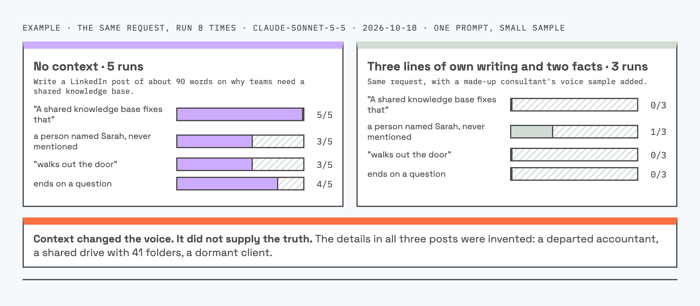

# erica

Last updated: 2026-10-20 14:17

Website: https://salteddana.github.io/erica/

A Claude Code skill (an add-on that gives Claude a new ability) that coaches you to explain an idea so people listen. Give it an idea and it picks a structure, writes a skeleton and script, and (optionally) draws one central diagram. Give it a draft and it scores the draft out of 20 and tells you the three fixes that matter most.

[](skills/erica/references/playbook.md)
[](skills/erica/references/playbook.md)
[](skills/erica/references/playbook.md)
[](LICENSE)

## Credit

Created by Dana Maman.

I came across Erica Mallett's YouTube channel, Theory Of One (https://www.youtube.com/@ericamallett), and was so impressed that I built this skill right away. It works wonderfully, and here it is.

- It is inspired by 20 of her public videos and two long interviews with her. It is my own interpretation plus my own quality rules, not her official method.
- It is not affiliated with her and she has not endorsed it.
- Her scripts, transcripts, examples, and named frameworks are not reproduced here.
- Watch her channel and learn from the source.
- If Erica asks, I will remove the mention of her or the whole skill.

## Install

You only need Claude Code. No terminal commands.

1. On this page, click the green **Code** button near the top, then **Download ZIP**. Your computer saves a file called `erica-main.zip`, usually in your Downloads folder. If you cannot find it, search your computer for `erica-main`. If it already opened into a folder, write "folder" instead of "zip" in the message below.
2. Open Claude Code and paste this message (`~/.claude/skills/` is Claude's add-on folder):

```
Open erica-main.zip from my Downloads folder and copy the folder skills/erica inside it to ~/.claude/skills/ so I can use the /erica skill. Do not run anything else from the files.
```

   Claude may ask permission to read your Downloads folder and to add the new folder. Say yes. The message only lets it copy one folder. If it asks whether to replace an existing `erica` folder, say yes.
3. Close Claude Code and open it again. Your chat will be empty, which is fine.
4. Type `/erica` followed by your idea, for example `/erica why customers do not use the tool I built them`. If Claude answers with questions about your idea, the skill is working. You can also paste a draft and ask for a review.

The skill asks three questions first: who is listening, what they should understand or do afterward, and the format. Answer briefly. Give it one real detail of your own (a case, a number, a sentence a client said). Without one, it writes an imagined scene and tells you so.

## Two modes

**Coach.** You give an idea. The skill asks who listens, what they should do afterward, and the format. It finds the insight first, picks a structure, writes a skeleton and a script, and replaces every sentence any other speaker could say with a specific detail.

**Review.** You paste a draft. The skill scores it against ten checks, names the weakest beat, gives at most three fixes ranked by leverage, and rewrites one example of the top fix.

## Four structures

The skill picks one per piece and says why. It does not mix them.


## Nine beats

Each beat has one job. A draft that skips a beat scores lower.


## Review rubric

Ten checks, each scored 0, 1, or 2.


## Example

One real run on the question "why do AI-written posts all sound the same?" The numbers come from running the same request 8 times.



The skill turned that test into a short video script with a diagram. See [`examples/ai-sounds-the-same`](examples/ai-sounds-the-same) for the script, the claims table, and the 8 raw outputs. The sample is small: one model, one prompt, one day.

## What is inside

- `skills/erica/SKILL.md`: the workflow (coach mode, review mode, optional diagram step).
- `skills/erica/references/playbook.md`: structures, beats, delivery devices, rubric, diagram picks, and a worked example.
- `examples/ai-sounds-the-same/`: a saved run of the skill, with the raw outputs behind it.
- `scripts/build_assets.py`: regenerates the images and badges in `assets/`.
- `docs/index.html`: a landing page for GitHub Pages.

## Optional: a diagram

A good explanation has one central picture. If Excalidraw is connected to your Claude (as an MCP server), the skill draws that picture for you in black and white. If it is not connected, the skill puts a text diagram (Mermaid) in the script file instead. Nothing breaks either way, and you can add the connection later.

## After you have the script

Once the script is ready, you can ask Claude for the next step:

- Turn it into slides or a short animated video. Paste your script and ask, for example: "Turn this script into a carousel of square slides, one idea per slide."
- Record a voiceover. Paste the script into a voice tool such as ElevenLabs and pick a voice.

Both are optional. The skill itself only writes the script and the diagram.

## Background

Story-first explanation, naming an idea, concrete scenes, and rhetorical devices such as repetition and contrast are long-standing teaching and speechwriting techniques. This skill packages them as a workflow.

## Limits

- It does not check facts. Verify every research claim against its original source before you publish.
- The rubric and structures are a heuristic from a small sample of videos, not a tested method.
- Script length has no fixed target. The skill asks how long you want it, leans short, and never pads. For reference, the 20 videos I watched run 5 to 7 minutes at about 215 words per minute.

## License

MIT. See `LICENSE`.
