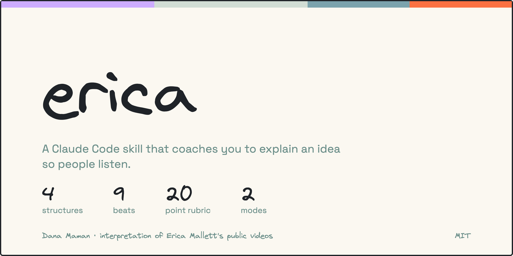
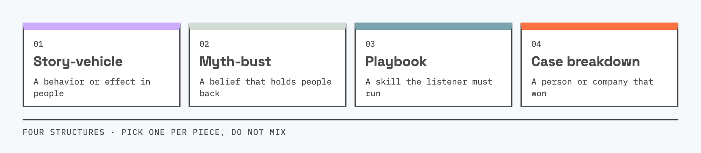
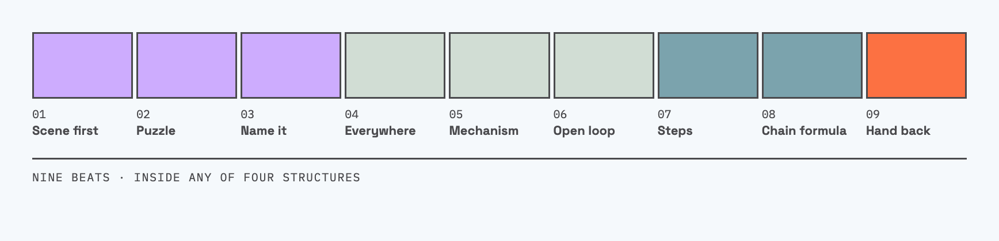
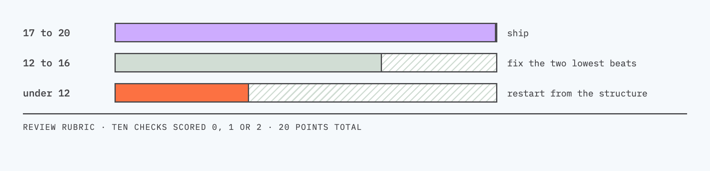

# erica

A Claude Code skill that coaches you to explain an idea so people listen. Give it an idea and it picks a structure, writes a skeleton and script, and (optionally) draws one central diagram. Give it a draft and it scores the draft out of 20 and tells you the three fixes that matter most.

[](skills/erica/references/playbook.md)
[](skills/erica/references/playbook.md)
[](skills/erica/references/playbook.md)
[](LICENSE)

## Credit

Created by Dana Maman.

I came across Erica Mallett's YouTube channel, Theory Of One (https://www.youtube.com/@ericamallett), and was so impressed that I built this skill right away. It works wonderfully, and here it is.

- It is my personal interpretation of 20 of her public videos, not her official method.
- It is not affiliated with her and she has not endorsed it.
- Her scripts, transcripts, examples, and named frameworks are not reproduced here.
- Watch her channel and learn from the source.
- If Erica asks, I will remove the mention of her or the whole skill.

## Install

Copy the skill folder into your Claude Code skills directory:

```bash
cp -R skills/erica ~/.claude/skills/
```

Restart Claude Code, then type `/erica` or ask: "help me explain [your idea]". You can also paste a draft and ask for a review.

## Two modes

**Coach.** You give an idea. The skill asks for the listener, the outcome, and the format, picks a structure, checks that the idea has a core, a surprise, a name, a turn to the listener, and an exercise, then writes a skeleton and a 900 to 1,200 word script.

**Review.** You paste a draft. The skill scores it against ten checks, names the weakest beat, gives at most three fixes ranked by leverage, and rewrites one example of the top fix.

## Four structures

The skill picks one per piece and says why. It does not mix them.



## Nine beats

Each beat has one job. A draft that skips a beat scores lower.



## Review rubric

Ten checks, each scored 0, 1, or 2.



## What is inside

- `skills/erica/SKILL.md`: the workflow (coach mode, review mode, optional diagram step).
- `skills/erica/references/playbook.md`: structures, beats, delivery devices, rubric, diagram picks, and a worked example.
- `scripts/build_assets.py`: regenerates the images and badges in `assets/`.
- `docs/index.html`: a landing page for GitHub Pages.

## Optional: diagrams

If you have an Excalidraw MCP server connected, the skill draws one black-and-white diagram of the central picture. Without it, the skill describes the diagram in text. Nothing breaks either way.

## Background

Story-first explanation, naming an idea, concrete scenes, and rhetorical devices such as repetition and contrast are long-standing teaching and speechwriting techniques. This skill packages them as a workflow.

## Limits

- It does not check facts. Verify every research claim against its primary source before you publish.
- The rubric and structures are a heuristic from a small sample of videos, not a tested method.
- The script length target comes from word counts of the 20 videos I watched (median about 1,500 spoken words, 5 to 7 minutes).

## License

MIT. See `LICENSE`.
