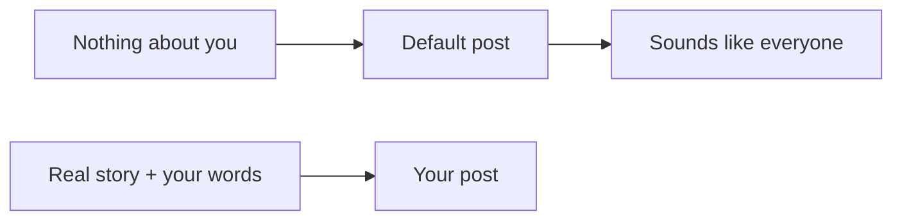

# Why AI posts all sound the same: short video script

Structure: Story-vehicle. Your five-run experiment is the scene.
Delivery devices: contrast-reveal, repeating-frame list, signpost questions, name every part, specific over general.
Listener: managers and business owners who already use AI for posts and emails.
Action: before asking AI to write, give it one real story and one sample of your own writing.

## SPOKEN SCRIPT

[SCENE]
I asked one AI the same request five times.
"Write a LinkedIn post, about ninety words, on why teams need a shared knowledge base."

Five posts. Five times, the sentence: "A shared knowledge base fixes that."
Three times, a person named Sarah. I never mentioned a Sarah.
Three times, knowledge "walks out the door."
Four times, it ended on a question.

Five different posts. One post.

[PUZZLE]
So why?

[NAME]
Because I gave it nothing about me. So it wrote the default post.
The default post is what AI writes when it knows nothing specific about you.

[EVERYWHERE]
Check your last five. Same opener. Same turn of phrase. Same ending.
You'll hear it everywhere now. Sorry.

[MECHANISM]
With nothing specific to go on, it reaches for the most common shape of the topic. That's my reading, not a proof.

[OPEN LOOP]
So I changed one thing. And it worked. Sort of.

[TEST]
I gave it three lines from a consultant's own writing, and two facts about her firm. Same request, three times.

"Fixes that"? Zero of three. Ending question? Zero of three. Real details.

But the details were made up. A departed accountant. A shared drive with 41 folders. A dormant client.
And two of the three still said: "That's not this. That's that."

[SIGNPOST]
So what does that tell you?
Context kills the default. It doesn't supply the truth. Only you can.

[STEPS]
So before you ask for anything:
One. Give it one real story. Something that happened, with a person, a date, a thing.
Two. Give it one sample of your own writing. A paragraph you wrote, and liked.
Three. Read the draft and check every detail against what happened.

[PAPER EXERCISE]
Two minutes, on paper. Finish this sentence:
"Last month, [who] [did what], and [what happened]."
That's your story.

[CHAIN]
Generic input, generic post. Real story plus your own words, a post only you could write.

[HAND BACK]
Open your last AI post. Highlight every sentence a competitor could publish unchanged.
That's where your story goes.

## END OF SPOKEN SCRIPT

## Diagram (central picture: chain of arrows), place at [CHAIN]

## Notes

- Pre-empt the misread: the line "Context kills the default. It doesn't supply the truth." is there so nobody hears "add context and the AI is safe to publish." The invented accountant is the warning.
- The "sorry" joke is on a transition line, not on a key line.
- Step 3 (check every detail) is my addition, drawn from your invented-details finding. It is not a tested step.
- Sample size is small (5 plain runs, 3 with context, one model, one prompt). Say so on screen or in the caption. Suggested caption line: "Small test: 5 plain runs, 3 with context, one model, one prompt."
- The "Check your last five" line asks viewers to look for themselves. It makes no claim about their posts.
